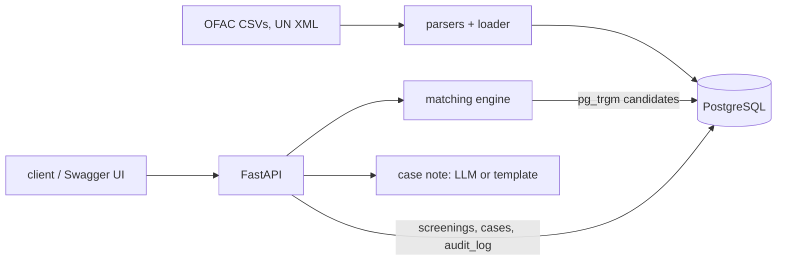

# sanctions-screener

[](https://github.com/RutuK2005/sanctions-screener/actions/workflows/ci.yml)

A name screening service for the OFAC SDN and UN Security Council sanctions lists. You send it a person or company, it fuzzy-matches the name against both lists, explains every hit, and opens a case for a human to clear, escalate or confirm. Every decision goes into an audit log that the database itself won't let you edit.

I wanted to see how far Postgres trigram search plus a careful re-scoring step in Python gets you on real list data, and to build the boring parts a compliance team actually needs around it (case states, idempotent requests, an audit trail).

Stack: FastAPI, SQLAlchemy 2, Alembic, PostgreSQL 16 with `pg_trgm`, rapidfuzz, pytest. There's no frontend; you use the Swagger UI at `/docs`.

## How it works



**Ingest.** `app/ingest/parsers.py` reads the OFAC `sdn/alt/add.csv` files and the UN consolidated XML (through defusedxml) into one entity-plus-aliases shape. The loader upserts on `(source, source_id)`, marks entities that drop off a newer version as delisted instead of deleting them, and records each load in `list_versions`.

**Matching** (`app/matching/`):

1. Normalise list names at ingest and the query at request time with the same function: strip accents, casefold, drop punctuation, honorifics and legal forms (`LLC`, `S.A. de C.V.`, even `Lmiited`), turn `LAST, First` into `first last`, and map the Mohammed/Muhammad spellings to one token.
2. Pull up to 150 candidate names from Postgres with `name_norm % q UNION q <% name_norm`, both on a GIN trigram index. I used `UNION` because with `OR` the planner sometimes fell back to a sequential scan (around 360 ms instead of around 25 ms).
3. Re-score each candidate. The name score is the higher of rapidfuzz's `token_sort_ratio` and a token alignment score (`0.7 * query coverage + 0.3 * candidate coverage`, using Jaro-Winkler per token, where pairs under 0.8 count as zero and an initial matching a full name counts 0.9). Then small adjustments: exact DOB +0.05, same year +0.02, more than a year apart -0.10, country linked +0.03 or not -0.05, person vs company mismatch -0.10. Anything missing on either side is neutral.
4. Keep the best alias per entity. A score of 0.88 or more is a hit and opens a case.

For example, `Aiman Zawahri` with DOB 1951-06-19 against OFAC 2676 `AL ZAWAHIRI, Dr. Ayman` (normalised to `ayman al zawahiri`) gets token_sort 0.800 and alignment 0.881, so the name score is 0.881, and the exact DOB brings it to 0.931. All of these numbers come back in the `explanation` field of each hit.

**Cases.** A case starts `open` and can be cleared, confirmed or escalated; an escalated case can only be cleared or confirmed. Anything else returns 409, and decisions take a row lock so two reviewers can't both act on the same case. A trigger on `audit_log` rejects `UPDATE` and `DELETE`.

**Case notes.** `POST /cases/{id}/summary` writes a short analyst note with Claude (`claude-sonnet-5-5`) if `ANTHROPIC_API_KEY` is set, and falls back to a template built from the same evidence if it isn't or the call fails. The model only summarises; it never decides a case.

## Running it

You need Python 3.12+ (I develop on 3.14, CI runs 3.12). Docker isn't needed; `scripts/localpg.py` runs a throwaway Postgres from the portable EnterpriseDB binaries.

```bash
python -m venv .venv
.venv/Scripts/activate              # Linux/macOS: source .venv/bin/activate
pip install -r requirements-dev.txt

python scripts/localpg.py download  # Windows: ~300 MB of binaries into .pg/
python scripts/localpg.py start     # 127.0.0.1:54329, creates screener, screener_test, screener_eval
alembic upgrade head

python -m app.cli download          # real lists into data/raw/
python -m app.cli ingest-ofac data/raw
python -m app.cli ingest-un data/raw/un_consolidated.xml
# offline: ingest-ofac tests/fixtures/ofac and ingest-un tests/fixtures/un_sample.xml

uvicorn app.main:app --reload       # http://localhost:8000/docs, API key dev-key
```

On Linux or macOS, install Postgres 16 with contrib and point the script at it: `PG_BIN=/usr/lib/postgresql/16/bin python scripts/localpg.py start`. Settings (`DATABASE_URL`, `API_KEY`, `MATCH_THRESHOLD`, `ANTHROPIC_API_KEY`) come from the environment or a `.env` file, see `.env.example`.

A screening against the full lists:

```bash
curl -s -X POST localhost:8000/screenings \
  -H "X-API-Key: dev-key" -H "Content-Type: application/json" -H "Idempotency-Key: demo-1" \
  -d '{"name":"Aiman Zawahri","entity_type":"individual","dob":"1951-06-19"}'
```

This returns two hits (UN QDi.006 at 0.9467 through the alias `Ayman Al-Zawahari`, OFAC 2676 at 0.9314) and `case_id: 1`. Sending the same `Idempotency-Key` again returns the stored result with `Idempotent-Replay: true` and doesn't open a second case. `Rahul Sharma` comes back clean; its best candidate scores 0.806. The other endpoints are `GET /screenings/{id}`, `GET /cases`, `GET /cases/stats`, `GET /cases/{id}`, `POST /cases/{id}/decision`, `GET /cases/{id}/audit` and `GET /health`. There's also a CLI: `python -m app.cli screen "Zawahiri, Ayman" --dob 1951 --explain`.

Tests run against a real Postgres (`screener_test` by default, or set `TEST_DATABASE_URL`), because `pg_trgm` can't be faked with SQLite. The database is wiped and migrated once per session and loaded from `tests/fixtures/` (300 OFAC and 30 UN entities).

```bash
pytest
ruff check .
```

The `Dockerfile` and `docker-compose.yml` are there for anyone with Docker, but I haven't run them since I don't have Docker on my machine. CI does use the `postgres:16` image as a service container: it runs ruff, `alembic upgrade head` and `downgrade base`, then pytest.

## Results

`scripts/eval.py` builds a labelled set from whatever list is loaded: 1,000 real OFAC names, each perturbed once (typo, transliteration-style spelling swap, reordered tokens, dropped middle name, or first name cut to an initial), and 1,000 made-up names from several regions plus generic company names. A positive only counts if the correct entity is among the hits. The committed run was against the full OFAC SDN list, 19,595 active entities and 37,968 names including aliases, with seed 7 ([docs/eval-output.txt](docs/eval-output.txt), [docs/eval-results.json](docs/eval-results.json)).

| threshold | precision | recall | F1 | negatives that alerted |
|---:|---:|---:|---:|---:|
| 0.80 | 0.901 | 0.990 | 0.943 | 10.7% |
| 0.85 | 0.953 | 0.979 | 0.966 | 4.5% |
| 0.88 (default) | 0.974 | 0.968 | 0.971 | 2.3% |
| 0.90 | 0.980 | 0.959 | 0.969 | 1.8% |
| 0.95 | 0.992 | 0.838 | 0.908 | 0.3% |

Raw `pg_trgm` similarity on the same candidates peaks at F1 0.889 (threshold 0.70), so the re-scoring is worth about 8 points. At 0.88, recall by variant is 99.7% for reorders, 98.7% for initials, 96.0% for transliterations, 95.6% for dropped middle names and 93.5% for typos. `engine.screen()` (SQL plus re-scoring, not HTTP) took 8.9 ms at p50, 27.5 ms at p95 and 40.9 ms at p99 over 2,000 queries on my Windows laptop with Postgres 16.13.

If you want to rerun it, load OFAC into `screener_eval` and run `DATABASE_URL=postgresql+psycopg://postgres@127.0.0.1:54329/screener_eval python scripts/eval.py --show-errors 15 --out docs/eval-results.json`. The numbers shift a little as OFAC updates the list.

The variants are synthetic and generated by this repo, so this only tells you how well it copes with the perturbations I picked. It's not a measure of real screening quality. Some "negatives" are genuine name collisions too (`Dmitri Lebedev` alerts on `LEBEDEV, Dmitri Alekseevich`), which is exactly why a person reviews every case.

## Limitations and next steps

The false alerts I looked at mostly come from short aliases and a generous Jaro-Winkler: `Bright Wave Consulting LLC` hits IPM LIMITED at 0.954 through its alias `B&W CONSULTING`, and `Pooja Martin` hits GUSEV, Denis Igorevich at 0.944 through the alias `POMOJAC, Marin`. I think weighting rare tokens more than common ones would help with both. On the other side, very short names with a typo can miss retrieval entirely (`Sietm` never finds `SITEM`), and a phonetic key like Double Metaphone as a second retrieval path should fix that. That's probably what I'll add next.

Other gaps:

- No matching on non-Latin scripts. The UN list's original-script names are stored but nothing transliterates them.
- One shared API key and no roles; `reviewer` comes from the request body, and rejected (409) decisions aren't audited.
- The table owner can still `TRUNCATE` the audit log. In production the app role would only get `INSERT` and `SELECT`.
- No rescreening of existing customers when a list updates.
- OFAC DOBs and nationalities are pulled out of the remarks text with regexes, and address countries count as "linked countries", which is broader than nationality.
- The tests cover the template note and the LLM-failure fallback, but not a live API call, and I haven't called the live API from this repo.

The list data is published by the US Treasury and the UN Security Council. Raw downloads are git-ignored, and `tests/fixtures/` holds a small verbatim subset so the tests run offline. This is a portfolio project, not a compliance product.
