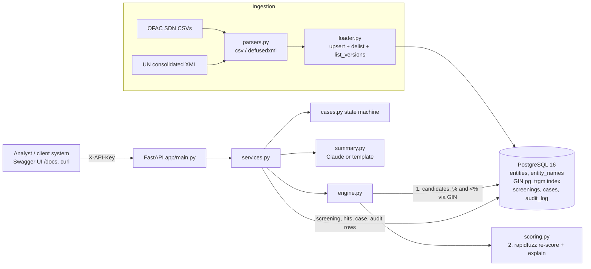

# Sanctions Screener

[](https://github.com/RutuK2005/sanctions-screener/actions/workflows/ci.yml)

A small, working **sanctions screening service**. It ingests the public **OFAC SDN** and
**UN Security Council** sanctions lists. It fuzzy-matches people and companies against
them with **PostgreSQL `pg_trgm` + `rapidfuzz`** and explains every match. Hits above the
threshold go into a **case workflow** (open → escalated → cleared / confirmed match),
backed by a database-enforced **append-only audit log**.

Pure Python: **FastAPI · SQLAlchemy 2 · Alembic · PostgreSQL 16 · Pydantic v2 · rapidfuzz · pytest · GitHub Actions**.
Analysts use the API through FastAPI's built-in **Swagger UI at `/docs`**. There is no separate frontend.

---

## What it does

| Capability | Where |
|---|---|
| Download + parse OFAC SDN (`sdn/alt/add.csv`) and UN consolidated XML into one entity/alias model (name, type, programs, countries, DOBs, source id) | `app/ingest/parsers.py` |
| Idempotent upsert on `(source, source_id)`; entities that drop off a list are marked **delisted**, not deleted; every load recorded in `list_versions` | `app/ingest/loader.py` |
| Name normalisation: case, diacritics, punctuation, honorifics, legal forms (`LLC`, `S.A. de C.V.`, `Aktsionernoe Obshchestvo`…), `LAST, First` reordering | `app/matching/normalize.py` |
| Candidate retrieval with `pg_trgm` (`%` and `<%`) on a **GIN index**, then re-scoring with token-sort ratio + Jaro-Winkler token alignment, plus DOB / country / type adjustments | `app/matching/engine.py`, `scoring.py` |
| Per-hit **explanation**: matched alias, normalised strings, every score component and adjustment with a reason | `explanation` field in API responses |
| `POST /screenings` auto-opens a case above threshold; `Idempotency-Key` makes retries safe | `app/services.py` |
| Case state machine; invalid transitions → **409**; row lock (`SELECT … FOR UPDATE`) against concurrent decisions | `app/cases.py` |
| Append-only `audit_log`: a Postgres trigger rejects `UPDATE`/`DELETE` | `alembic/versions/0001_initial.py` |
| Optional Claude-written analyst note (`claude-sonnet-5-5`), with a deterministic template fallback when no key is set or the call fails | `app/summary.py` |
| Offline evaluation: precision / recall / F1 per threshold, pg_trgm-only baseline, p50/p95/p99 latency | `scripts/eval.py` |

## Architecture



## How matching works

1. **Normalise** both list names (at ingest) and the query (at request time) with the same
   function: NFKD + strip combining marks (`Müller` → `muller`), casefold, drop apostrophes
   (`O'Brien` → `obrien`), punctuation → space, collapse dotted acronyms (`L.L.C.` → `llc`),
   reorder `LAST, First` → `first last`, drop honorifics (`Dr`, `Sheikh`…) and legal forms
   (also when misspelt by one edit, e.g. `Lmiited`), and map the `Mohammed/Mohamed/Muhammad`
   family to one token.
2. **Retrieve** up to 150 candidate names from Postgres:
   `name_norm % q` (trigram similarity ≥ 0.25) **UNION** `q <% name_norm` (word similarity ≥ 0.5,
   which catches short queries against long list names). Both use the GIN index. With
   `OR` instead of `UNION`, `EXPLAIN ANALYZE` showed the planner falling back to a sequential
   scan on some queries (~360 ms). The `UNION` form ran in ~29 ms on the same query.
3. **Re-score** each candidate in Python:
   * `token_sort` = rapidfuzz `token_sort_ratio` / 100
   * `token_alignment` = 0.7 × *query coverage* + 0.3 × *candidate coverage*. Coverage is the
     mean, over one side's tokens, of the best Jaro-Winkler similarity with any token on the
     other side. An initial (`A.`) matching `Ayman` counts 0.9. A pair below JW 0.8 counts 0.
     Query coverage is length-weighted. Candidate coverage counts each token once (1–2 letter
     particles like `al` count 0.3), so a missing middle name or patronymic only costs a little.
   * `name_score = max(token_sort, token_alignment)`
   * `final = clamp(name_score + dob + country + type)` with DOB exact **+0.05**, same year
     **+0.02**, >1 year apart **−0.10**; country linked **+0.03**, not linked **−0.05**;
     individual-vs-entity mismatch **−0.10**. A missing value on either side is neutral.
4. **Keep the best alias per entity.** Hits at or above the threshold (default **0.88**, chosen by
   F1 below) are returned with their explanation, and a case is opened.

Worked example (from the running API): `"Aiman Zawahri"`, DOB `1951-06-19` vs OFAC 2676
`AL ZAWAHIRI, Dr. Ayman` → normalised `aiman zawahri` vs `ayman al zawahiri`.
token_sort 0.800, query coverage 0.919, candidate coverage 0.794, alignment 0.881 → name 0.881,
plus exact DOB +0.05 → **0.931**.

## Evaluation (real numbers)

`scripts/eval.py` builds a labelled set from the list that is loaded:

* **1,000 positives**: real OFAC SDN names (individuals and entities, primary name or a random
  alias), each perturbed once: typo, transliteration-style spelling swap (`ou→u`, `kh→h`,
  `y→i`, `c→k`…), token reorder, dropped middle name, or first name → initial.
  A positive is a true positive only if **the correct entity** is among the hits at or above the threshold.
* **1,000 negatives**: random first+last name combinations from several regions (Indian,
  Chinese, Japanese, Korean, Hispanic, Russian, Arabic, African, European, Anglo) plus generic
  company names. Exact list names (after normalisation) are excluded.

Run on **2026-11-20** against the **full OFAC SDN list: 19,595 entities / 37,968 names incl.
aliases** (download of 2026-11-18, file hash `sha256:481d9e70f812c8d4`). Seed 7, name-only queries
with entity type supplied. Raw output: [`docs/eval-output.txt`](docs/eval-output.txt),
[`docs/eval-results.json`](docs/eval-results.json).

| threshold | precision | recall | F1 | negatives that alerted |
|---:|---:|---:|---:|---:|
| 0.80 | 0.901 | 0.990 | 0.943 | 10.7 % |
| 0.85 | 0.953 | 0.979 | 0.966 | 4.5 % |
| **0.88 (default)** | **0.974** | **0.968** | **0.971** | **2.3 %** |
| 0.90 | 0.980 | 0.959 | 0.969 | 1.8 % |
| 0.92 | 0.984 | 0.900 | 0.940 | 0.8 % |
| 0.95 | 0.992 | 0.838 | 0.908 | 0.3 % |

**Baseline: raw `pg_trgm` similarity alone** (same candidates, no re-scoring) peaks at
F1 **0.889** (P 0.924 / R 0.856 at 0.70). The re-scoring stage is worth about +8 F1 points.

Recall by variant at 0.88: reorder 99.7 %, initial 98.7 %, transliteration 96.0 %,
dropped middle name 95.6 %, typo 93.5 %.

**Screening latency** (`engine.screen()`: SQL retrieval + Python re-scoring, warm connection,
2,000 queries): **p50 8.9 ms · p95 27.5 ms · p99 40.9 ms** (mean 11.6 ms).
Measured on a Windows 11 laptop, Python 3.14.6, local PostgreSQL 16.13. This is not HTTP
round-trip time.

What the numbers do **not** say: the variants are synthetic and generated by this repo, so
they measure robustness to the perturbations I chose, not real-world screening quality. The
transliteration rules are not in the matcher's canonicalisation table (only the Muhammad
family is), but the overlap is not zero. Some "negatives" are genuine name collisions
(`Dmitri Lebedev` vs the listed `LEBEDEV, Dmitri Alekseevich`). That is exactly the
false-positive problem analysts deal with, and the reason a human reviews every case.

## API

Start the API (see *Run locally*), then open **http://localhost:8000/docs**. Click
**Authorize** and enter the API key (`dev-key` by default).

| Method | Path | Notes |
|---|---|---|
| GET | `/health` | public; DB check + latest version of each list |
| POST | `/screenings` | screen a person/company; `Idempotency-Key` header supported |
| GET | `/screenings/{id}` | stored result |
| GET | `/cases?status=open&limit=20&offset=0` | queue, newest first; `total` for pagination |
| GET | `/cases/stats` | count per status |
| GET | `/cases/{id}` | evidence, explanation, allowed decisions, audit trail |
| POST | `/cases/{id}/decision` | `clear` / `escalate` / `confirm_match` + reviewer + note; 409 if not allowed |
| GET | `/cases/{id}/audit` | append-only trail |
| POST | `/cases/{id}/summary` | analyst note (Claude if `ANTHROPIC_API_KEY` is set, else template) |

Examples below are real responses from the local server, trimmed:

```bash
curl -s -X POST localhost:8000/screenings \
  -H "X-API-Key: dev-key" -H "Content-Type: application/json" -H "Idempotency-Key: demo-1" \
  -d '{"name":"Aiman Zawahri","entity_type":"individual","dob":"1951-06-19"}'
```
```json
{"id":1,"query_name":"Aiman Zawahri","threshold":0.88,"top_score":0.9467,"hit_count":2,
 "hits":[{"source":"UN_SC","source_id":"QDi.006","primary_name":"AIMAN MUHAMMED RABI AL-ZAWAHIRI",
          "matched_name":"Ayman Al-Zawahari","score":0.9467,
          "explanation":{"query_normalized":"aiman zawahri","candidate_normalized":"ayman al zawahari",
            "name":{"score":0.8967,"token_sort_ratio":0.8,"query_coverage_jw":0.9354,
                    "candidate_coverage_jw":0.8065,"token_alignment":0.8967,"trigram_similarity":0.5},
            "adjustments":{"dob":{"value":0.05,"reason":"exact DOB match 1951-06-19"},
                           "country":{"value":0.0,"reason":"not compared (missing on one side)"},
                           "type":{"value":0.0,"reason":"type agrees"}},"final_score":0.9467}},
         {"source":"OFAC_SDN","source_id":"2676","primary_name":"AL ZAWAHIRI, Dr. Ayman","score":0.9314, "...": "..."}],
 "case_id":1,"latency_ms":...}
```

```bash
# Same Idempotency-Key again -> HTTP 200, header Idempotent-Replay: true, same id, no second case.

curl -s "localhost:8000/cases?status=open&limit=5" -H "X-API-Key: dev-key"
# {"items":[{"id":1,"status":"open","top_score":0.9467,"query_name":"Aiman Zawahri","hit_count":2,...}],"total":1,"limit":5,"offset":0}

curl -s -X POST localhost:8000/cases/1/decision -H "X-API-Key: dev-key" -H "Content-Type: application/json" \
  -d '{"decision":"escalate","reviewer":"analyst.priya","note":"Name + exact DOB match; needs L2 review"}'
# -> 200, "status":"escalated", "allowed_decisions":["clear","confirm_match"]

# escalating again:
# -> 409 {"detail":"cannot 'escalate' a case that is 'escalated'","status":"escalated","allowed_decisions":["clear","confirm_match"]}

curl -s -X POST localhost:8000/cases/1/summary -H "X-API-Key: dev-key"
# {"case_id":1,"source":"template","summary":"'Aiman Zawahri' matched 2 listing(s) at or above threshold 0.88.
#  Strongest: AIMAN MUHAMMED RABI AL-ZAWAHIRI (UN_SC QDi.006; programs: Al-Qaida) via alias 'Ayman Al-Zawahari',
#  score 0.947 (name 0.897). DOB: exact DOB match 1951-06-19 (+0.05). ..."}
```

A clean name (`"Rahul Sharma"`) returns `hit_count: 0`, `case_id: null`. Its best candidate
scored 0.806, below the 0.88 threshold. Requests without a valid `X-API-Key` get 401.

There is also a CLI: `python -m app.cli screen "Zawahiri, Ayman" --dob 1951 --explain`.

## Run locally

Prerequisites: Python 3.12+ (developed on 3.14, CI uses 3.12). Docker is **not** required.

```bash
python -m venv .venv && .venv/Scripts/activate        # Linux/macOS: source .venv/bin/activate
pip install -r requirements-dev.txt

# PostgreSQL 16 without Docker or an installer (what was actually used during development):
python scripts/localpg.py download   # Windows: fetches EDB portable binaries (~300 MB) into .pg/
python scripts/localpg.py start      # initdb + start on 127.0.0.1:54329, creates screener / screener_test / screener_eval
#   Linux/macOS: install postgresql + contrib, then PG_BIN=/usr/lib/postgresql/16/bin python scripts/localpg.py start

alembic upgrade head
python -m app.cli download                                  # real lists -> data/raw/ (git-ignored)
python -m app.cli ingest-ofac data/raw                      # ~19.6k entities, a few seconds
python -m app.cli ingest-un data/raw/un_consolidated.xml
#   offline alternative: python -m app.cli ingest-ofac tests/fixtures/ofac

uvicorn app.main:app --reload                               # http://localhost:8000/docs
```

Configuration (environment variables or `.env`, see `.env.example`): `DATABASE_URL`, `API_KEY`,
`MATCH_THRESHOLD` (default 0.88), `ANTHROPIC_API_KEY` (optional).

**Tests:** `pytest`: **88 tests**, run against a real PostgreSQL (`screener_test`, wiped and
migrated from scratch each session, loaded from `tests/fixtures/`). Set `TEST_DATABASE_URL` to
point elsewhere. Lint: `ruff check .`

**Evaluation:** load OFAC into `screener_eval`, then
`DATABASE_URL=postgresql+psycopg://postgres@127.0.0.1:54329/screener_eval python scripts/eval.py --out docs/eval-results.json`.

**Docker:** `docker-compose.yml` (postgres:16 + api) and a `Dockerfile` are included for
convenience, but **I could not run them locally** because Docker isn't installed on the
development machine. The CI pipeline does use the official `postgres:16` image as a service container.

## CI

GitHub Actions ([`.github/workflows/ci.yml`](.github/workflows/ci.yml)): Python 3.12, `postgres:16`
service container → `ruff check` → `alembic upgrade head` + `downgrade base` → `pytest`.

## Limitations / TODO

Known weaknesses, found by reading the eval's error list:

* **Initials on the list side** match whole query words: `Bright Wave Consulting LLC` alerts on
  the alias `B&W CONSULTING` (0.954). **Jaro-Winkler is generous** to some unrelated pairs
  (`Pooja Martin` vs alias `POMOJAC, Marin`, 0.944). A token-frequency weight (rare tokens
  count more) would help both.
* **Very short names** with a typo can fall below the trigram retrieval floor (`Sietm` for
  `SITEM`). Phonetic keys (Double Metaphone) as a second retrieval path would help.
* **No non-Latin script matching.** Arabic/Cyrillic/CJK original-script names from the UN list
  are stored, but nothing transliterates them, and only the Muhammad spelling family is canonicalised.
* **Evaluation is synthetic** (see above). There are no real labelled alert outcomes, and
  thresholds are not tuned per list or per segment.
* **Single API key**, no users/roles. `reviewer` is taken from the request body instead of an
  authenticated identity. Rejected (409) decision attempts are not audited.
* **The audit log can still be `TRUNCATE`d** by the table owner (the trigger only blocks row
  UPDATE/DELETE). In production the app role would get INSERT/SELECT only.
* **No rescreening.** When a list updates, existing customers are not re-screened against the
  delta. Only new screenings see new entries.
* OFAC remarks are parsed with regexes (DOB, nationality). The OFAC advanced XML / UN DOB
  ranges would give more structured data. Address countries are used as "linked countries",
  which is broader than nationality.
* The LLM summary path is not covered by tests (by design, no network in CI). Only the
  template fallback and the "LLM failed → template" path are tested. I have not called the
  live API from this repo.
* `docker-compose.yml` was not run locally (no Docker on the dev machine).

## Data & licence

OFAC SDN data is published by the US Treasury, and the UN consolidated list by the UN
Security Council. Raw downloads are git-ignored. `tests/fixtures/` contains a 300-entity OFAC
and 30-entity UN subset, copied verbatim so tests run offline. This project is for learning and
demonstration. It is not a compliance product.
